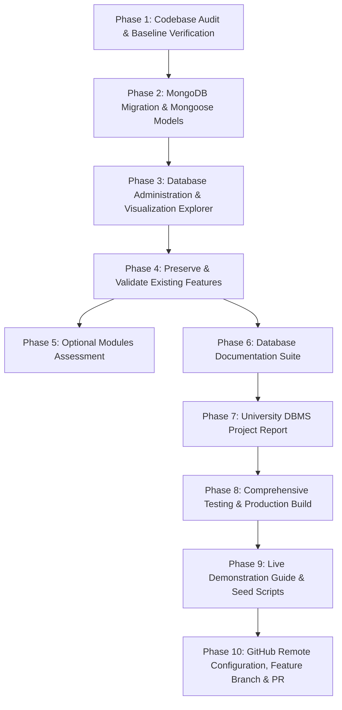

# CampusConnect — Implementation Plan & Roadmap

**Target Submission Date:** Tuesday, 17 November 2026  
**Candidate Project:** University DBMS Final Project Submission  
**Repository:** [https://github.com/Uddip07/dbms-project](https://github.com/Uddip07/dbms-project)  
**Database Target:** MongoDB Atlas / Mongoose (Sole Application Persistence Layer)

---

## Phase Breakdown & Milestone Schedule

---

## Phase 1 — Complete Repository Audit (COMPLETED)
- [x] Inspect package dependencies and toolchains.
- [x] Audit all client pages and server-rendered routes.
- [x] Audit all 21 API endpoints under `src/app/api`.
- [x] Audit authentication, authorization, session persistence, and middleware.
- [x] Audit environment configuration variables without exposing secrets.
- [x] Execute initial test suite (91 passing tests) and production build.
- [x] Author `PROJECT_AUDIT.md`.
- [x] Author `IMPLEMENTATION_PLAN.md`.

---

## Phase 2 — MongoDB Migration (Mongoose + Atlas)
- [ ] Add `mongoose` (`^8.10.x`) and `@types/mongoose` to `package.json`.
- [ ] Create centralized MongoDB connection manager in `src/db/mongodb.ts` (cached connection for Next.js hot-reloading and serverless lifecycle).
- [ ] Implement Mongoose models in `src/db/models/`:
  1. `User.ts` (`users`) — UUID/ObjectId, unique collegeId, unique collegeEmail, cohort ref, role enum, status enum, compound index.
  2. `Cohort.ts` (`cohorts`) — Unique graduationYear.
  3. `AnonymousIdentity.ts` (`anonymousidentities`) — User ref, unique displayName, avatarSeed, active status.
  4. `Room.ts` (`rooms`) — Type enum ('global' | 'cohort' | 'alumni'), name, cohort ref.
  5. `Message.ts` (`messages`) — Room ref, user ref, content, replyTo ref, moderation status, soft deletion, composite index `(roomId, createdAt, _id)`.
  6. `MessageReaction.ts` (`messagereactions`) — Message ref, user ref, reaction enum, unique compound index `(messageId, userId, reaction)`.
  7. `Report.ts` (`reports`) — Message ref, reporter ref, reason, status enum, reviewer ref, timestamp index.
  8. `Ban.ts` (`bans`) — User ref, type enum, reason, expiresAt, createdBy ref.
  9. `Announcement.ts` (`announcements`) — Title, content, author ref, audienceType enum, cohort ref, isPinned, publishedAt, expiresAt.
  10. `AnnouncementAttachment.ts` (`announcementattachments`) — Announcement ref, storagePath, fileName, mimeType, fileSize.
  11. `AuditLog.ts` (`auditlogs`) — Actor ref, action enum, targetType, targetId, metadata, timestamp index.
  12. `NotificationDevice.ts` (`notificationdevices`) — User ref, unique pushToken, platform, timestamps.
- [ ] Build stable composite cursor pagination for messages:
  - Base64-encoded `createdAt` + `_id` cursor.
  - Query filters: `createdAt < cursorTime` OR `(createdAt == cursorTime AND _id < cursorId)`.
- [ ] Migrate all API routes and services from Drizzle/Postgres to Mongoose models.
- [ ] Update `src/lib/auth/session.ts` to query user, cohort, active anonymous identity, and ban records from MongoDB.
- [ ] Update `src/lib/audit/logger.ts` to persist audit records directly into MongoDB `auditlogs`.
- [ ] Add database seeder `src/db/seed.ts` to initialize default cohorts (2025–2032), global rooms, and initial records for instant testing.

---

## Phase 3 — Database Administration and Visualization Explorer
- [ ] Create admin route `/admin/database` (`src/app/admin/database/page.tsx`).
- [ ] Implement server-side authorization check (Super Admin / Admin only).
- [ ] Create secure read-only Explorer API endpoints:
  - `GET /api/admin/database/overview` — Connection status, database name, collections list, document counts, indexes, and storage statistics.
  - `GET /api/admin/database/collections/[name]` — Paged document browser, search by ID or key-value fields, safe serialization of ObjectId and Date.
  - `GET /api/admin/database/collections/[name]/export` — Stream collection documents as formatted JSON download.
- [ ] Build rich client explorer component `src/components/admin/DatabaseExplorer.tsx`:
  - Connection health pill (MongoDB Atlas cluster status).
  - Collection navigator with document counts and index counts.
  - Interactive JSON document viewer with formatted timestamps and highlighted ObjectId references.
  - Paged table with filter/search bar.
  - Visual ER relationship schema map.
  - JSON export button.

---

## Phase 4 — Preserve and Finish Existing Features
- [ ] Verify Google OAuth & Supabase Auth callback flow with MongoDB user onboarding.
- [ ] Verify NSUT institutional email validation (`@nsut.ac.in`).
- [ ] Verify Chat rooms (All College, Cohort batch, Alumni room).
- [ ] Verify Realtime message broadcasting and reaction updates.
- [ ] Verify message soft-deletion (by author or staff).
- [ ] Verify reporting system and admin moderation desk.
- [ ] Verify official announcement feed, creation, and pinned priority.
- [ ] Verify privileged identity resolution and immutable audit logging.

---

## Phase 5 — Optional Features Review
- [ ] Review Lost & Found, Events, and Academic Info.
- [ ] Document non-core modules accurately as future milestones if not fully required for DBMS core rubric, ensuring zero fabrication.

---

## Phase 6 — Database Documentation Suite
Author the 8 university DBMS documentation artifacts in `docs/database/`:
1. `docs/database/ER_DIAGRAM.md` — Complete Entity-Relationship documentation.
2. `docs/database/ER_DIAGRAM.mmd` — Mermaid ER diagram source.
3. `docs/database/COLLECTIONS.md` — Detailed MongoDB collections and schema specifications.
4. `docs/database/RELATIONAL_SCHEMA.md` — Relational schema mapping, relations, and integrity constraints.
5. `docs/database/FUNCTIONAL_DEPENDENCIES.md` — Comprehensive functional dependencies per entity.
6. `docs/database/NORMALIZATION.md` — Mathematical normalization proofs (1NF, 2NF, 3NF, BCNF analysis, lossless join, dependency preservation).
7. `docs/database/MONGODB_SCHEMA.md` — Document data model, referencing vs embedding rationale, ObjectId types.
8. `docs/database/INDEXES.md` — Compound indexes, unique constraints, performance analysis.

---

## Phase 7 — Comprehensive DBMS Project Report
Author `docs/PROJECT_REPORT.md` covering all 27 university requirements:
- Title page, abstract, problem statement, objectives, scope.
- Existing vs proposed systems, functional and non-functional requirements.
- Architecture diagrams, complete ER diagrams and relational models.
- Functional dependencies, candidate keys, normalization proofs.
- MongoDB design rationale, Mongoose schemas, CRUD operations, indexing.
- API design, security, RBAC, genuine test results, limitations, future scope, references.

---

## Phase 8 — Testing and Build Verification
- [ ] Run `npm install` for newly added dependencies.
- [ ] Run `npm run typecheck` (`tsc --noEmit`).
- [ ] Update and execute test suite via Vitest.
- [ ] Run production build (`npm run build`).
- [ ] Generate real execution report in `docs/TESTING_REPORT.md`.

---

## Phase 9 — Demonstration Readiness
- [ ] Author `docs/DEMO_GUIDE.md`:
  - Step-by-step oral demonstration script.
  - Test user accounts and roles.
  - Verification walkthrough (Student Onboarding -> Global Chat -> Cohort Chat -> Reactions -> Flagging -> Admin Moderation Queue -> Identity Resolution -> `/admin/database` Visual Explorer).
  - Recovery and seeding instructions.

---

## Phase 10 — GitHub Submission
- [ ] Inspect `.gitignore` to guarantee complete exclusion of `.env`, `.env.local`, credentials, and artifacts.
- [ ] Configure remote `https://github.com/Uddip07/dbms-project.git`.
- [ ] Create branch `feature/campusconnect-final-submission`.
- [ ] Commit with message `feat: complete CampusConnect DBMS project`.
- [ ] Push to GitHub.
- [ ] Verify pushed commit and provide exact PR link.
