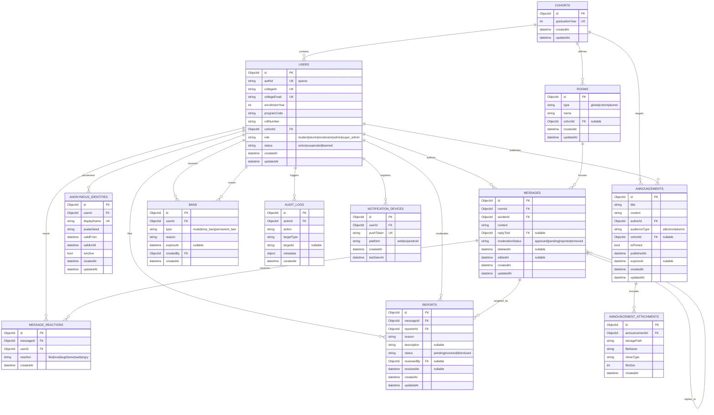

# CampusConnect — Entity-Relationship (ER) Model & Architecture

## 1. Conceptual Overview

CampusConnect is an academic and student collaboration platform for Netaji Subhas University of Technology (NSUT). The data layer models verified institutional users, cryptographic anonymous aliases, partitioned communication rooms, threaded messaging with reactions, content moderation queues, university announcements, and an immutable security audit trail.

This document describes the complete Entity-Relationship conceptual schema, attribute classifications, structural constraints (cardinality ratios and participation constraints), and relationship semantics.

---

## 2. Mermaid Entity-Relationship Diagram

---

## 3. Detailed Entity Set Specifications

### 3.1 Strong Entities
1. **`COHORTS`**: Represents graduating academic classes (e.g., Batch of 2026, 2027, ..., 2033).
   - Primary Key: `_id` (`ObjectId`).
   - Candidate Key: `graduationYear` (`int32`, Unique).
2. **`USERS`**: Institutional member profiles verified through `@nsut.ac.in` domain credentials and student ID parsing.
   - Primary Key: `_id` (`ObjectId`).
   - Candidate Keys: `collegeId`, `collegeEmail`, `authId` (sparse).
   - Derived Attributes: `role` (derived dynamically upon graduation: if $\text{currentYear} \ge \text{graduationYear}$, user transitions from `student` to `alumni`).
3. **`ROOMS`**: Communication channels partitioned by access tier (`global`, `cohort`, `alumni`).
   - Primary Key: `_id` (`ObjectId`).
   - Candidate Key: `(type, cohortId)` for cohort rooms.
4. **`ANNOUNCEMENTS`**: Official university administrative broadcasts published by staff.
   - Primary Key: `_id` (`ObjectId`).
5. **`AUDIT_LOGS`**: Immutable forensic log of privileged administrative and security actions.
   - Primary Key: `_id` (`ObjectId`).

### 3.2 Dependent & Associative Entities
1. **`ANONYMOUS_IDENTITIES`**: Decoupled public personas possessing a cryptographic handle (e.g., `AnonymousCosmicFox42`) and avatar seed.
   - Dependent on `USERS` through `userId`.
   - Candidate Key: `displayName`.
2. **`MESSAGES`**: Content items submitted by users within rooms.
   - Dependent on `ROOMS` (`roomId`) and `USERS` (`senderId`).
   - Recursive Unary Relationship: `replyToId` references parent message for hierarchical threading.
3. **`MESSAGE_REACTIONS`**: Lightweight associative entity modeling user emoji reactions to messages.
   - Dependent on `MESSAGES` (`messageId`) and `USERS` (`userId`).
   - Candidate Key: `(messageId, userId, reaction)`.
4. **`REPORTS`**: Content violation notices filed against specific messages for moderator review.
   - Dependent on `MESSAGES` (`messageId`) and `USERS` (`reporterId`, `reviewedBy`).
   - Candidate Key: `(messageId, reporterId)`.
5. **`BANS`**: Administrative sanctions restricting posting permissions or login access.
   - Dependent on `USERS` (`userId` target, `createdBy` issuer).
6. **`ANNOUNCEMENT_ATTACHMENTS`**: File metadata associated with administrative announcements.
   - Dependent on `ANNOUNCEMENTS` (`announcementId`).
7. **`NOTIFICATION_DEVICES`**: WebPush and mobile device push notification subscriptions.
   - Candidate Key: `pushToken`.

---

## 4. Relationship Sets, Cardinalities & Participation Constraints

| Relationship | Entity 1 | Cardinality | Entity 2 | Participation (Entity 1) | Participation (Entity 2) | Semantic Description |
|---|---|---|---|---|---|---|
| **Member Of** | `USERS` | $N : 1$ | `COHORTS` | **Total** (Every user must belong to a cohort) | **Partial** (A cohort may have 0 users initially) | Each user belongs to exactly one graduating cohort. |
| **Cohort Channel** | `ROOMS` | $N : 1$ | `COHORTS` | **Partial** (`global` and `alumni` rooms have no cohort) | **Partial** (A cohort has at most one cohort room) | Batch rooms are mapped to their specific graduation year. |
| **Identity Ownership** | `ANONYMOUS_IDENTITIES` | $N : 1$ | `USERS` | **Total** (Identity cannot exist without owner) | **Total** (Every verified user has at least one active identity) | Users possess anonymous aliases rotated or active over time. |
| **Room Posting** | `MESSAGES` | $N : 1$ | `ROOMS` | **Total** (Every message belongs to a room) | **Partial** (A room can exist with zero messages) | Messages are persisted within specific room channels. |
| **Message Author** | `MESSAGES` | $N : 1$ | `USERS` | **Total** (Every message has an author) | **Partial** (A user may never post a message) | Persistent reference to student author (decoupled in public API). |
| **Thread Reply** | `MESSAGES` | $N : 1$ | `MESSAGES` | **Partial** (Only reply messages reference parent) | **Partial** (A message may have 0 or many replies) | Recursive unary self-reference for message replies. |
| **User Reaction** | `MESSAGE_REACTIONS` | $N : 1$ | `MESSAGES` | **Total** | **Partial** | Emoji reactions attached to messages. |
| **Reaction Actor** | `MESSAGE_REACTIONS` | $N : 1$ | `USERS` | **Total** | **Partial** | User who reacted to the message. |
| **Report Target** | `REPORTS` | $N : 1$ | `MESSAGES` | **Total** | **Partial** | Flagged message subject to moderator triage. |
| **Reporter** | `REPORTS` | $N : 1$ | `USERS` | **Total** | **Partial** | Student filing content violation. |
| **Report Reviewer** | `REPORTS` | $N : 1$ | `USERS` | **Partial** (Null until staff acts) | **Partial** | Moderator/Admin resolving violation. |
| **Ban Target** | `BANS` | $N : 1$ | `USERS` | **Total** | **Partial** | Sanctioned student profile. |
| **Ban Issuer** | `BANS` | $N : 1$ | `USERS` | **Total** | **Partial** | Moderator/Admin issuing penalty. |
| **Announcement Author**| `ANNOUNCEMENTS` | $N : 1$ | `USERS` | **Total** | **Partial** | Admin authoring notice. |
| **Announcement Target**| `ANNOUNCEMENTS` | $N : 1$ | `COHORTS` | **Partial** (Only when `audienceType == 'cohort'`) | **Partial** | Cohort targeted by selective announcement. |
| **Attachment File** | `ANNOUNCEMENT_ATTACHMENTS` | $N : 1$ | `ANNOUNCEMENTS` | **Total** | **Partial** | Document metadata tied to announcement. |
| **Audit Actor** | `AUDIT_LOGS` | $N : 1$ | `USERS` | **Total** | **Partial** | Staff member triggering audited action. |
| **Device Owner** | `NOTIFICATION_DEVICES` | $N : 1$ | `USERS` | **Total** | **Partial** | Push device tokens registered by user. |

---

## 5. Security & Anonymity Architectural Decoupling

The Entity-Relationship model incorporates a strict **anonymity decoupling barrier**:
- Real student identification attributes (`collegeId`, `collegeEmail`, `rollNumber`, `programCode`, `authId`) are confined to `USERS`.
- Public discussion entities (`MESSAGES`, `MESSAGE_REACTIONS`) reference `USERS` strictly via internal system identifiers (`senderId`, `userId`), which are resolved to `ANONYMOUS_IDENTITIES.displayName` in application service layer queries.
- Public client responses never join or serialize the `USERS` identity attributes.
- Privilege de-anonymization is restricted to `super_admin` with mandatory justification, writing directly to `AUDIT_LOGS`.
